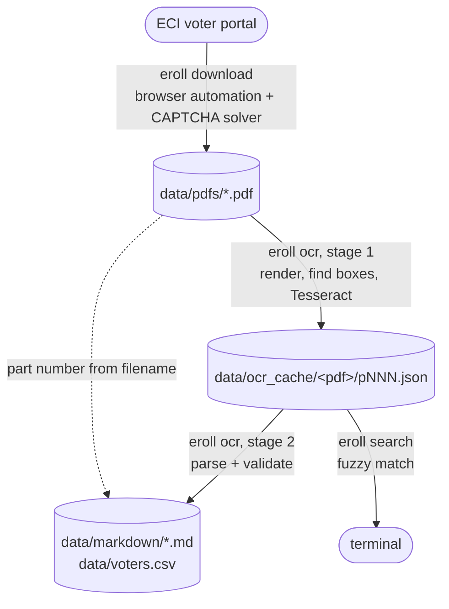
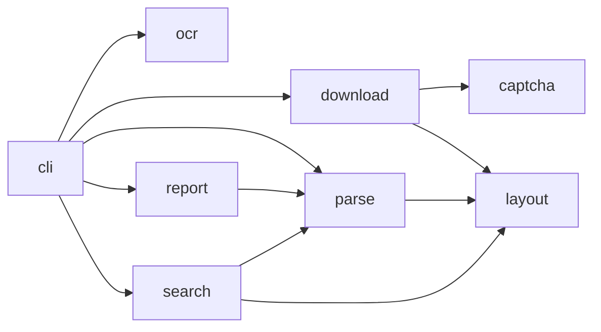
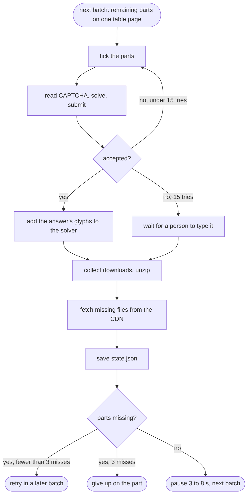
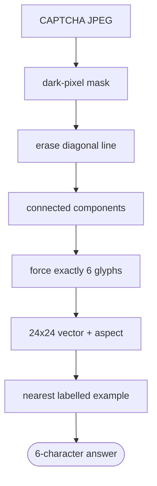
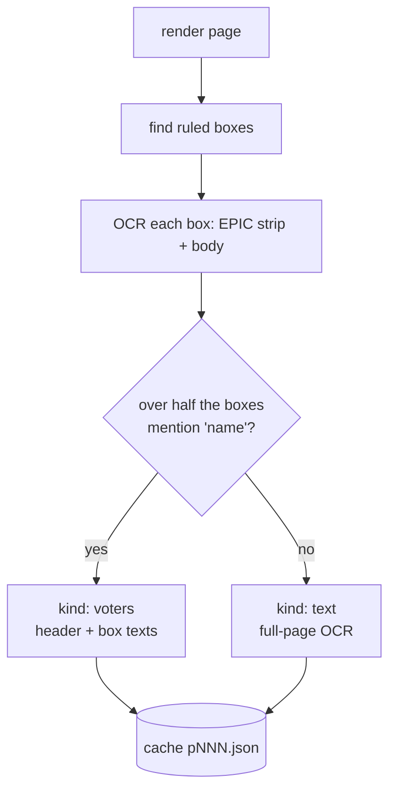

# Design

This document explains how `eroll` works and why it is built the way it is. The README covers
installation and usage.

## The problem

The ECI voter portal publishes each Assembly Constituency's electoral roll as a few hundred
"parts", one PDF per polling area. Getting a whole constituency by hand is slow:

- The portal lists parts in a paged table. You tick a page of parts at a time and solve a
  CAPTCHA for every download request.
- The PDFs are scanned images with no text layer, so they cannot be searched.
- Each page is a grid of about 30 ruled voter boxes. Each box holds an EPIC number, a name,
  a relative's name, a house number, an age and a gender.

`eroll` turns that into three commands that can be stopped and resumed: download, OCR, search.

## Pipeline



Each stage writes its results to disk before the next stage reads them. That has three
consequences:

- **Resumable.** Any stage can be interrupted and rerun. It skips work that is already on disk.
- **Cheap iteration.** OCR is by far the slowest step, and its raw output is cached,
  so changing a parsing regex and rerunning `eroll ocr` takes seconds, not hours.
- **Concurrency for free.** `eroll search` reads the OCR cache directly, so it can be used
  while OCR is still running.

## Module map

| Module | Responsibility | Heavy dependencies |
|---|---|---|
| `cli.py` | Argument parsing, wiring the modules together | none |
| `layout.py` | Data directory layout, filename conventions | none |
| `download.py` | Everything that talks to the portal | Playwright |
| `captcha.py` | CAPTCHA solver and its training | OpenCV, NumPy |
| `ocr.py` | Rendering pages, finding voter boxes, running Tesseract | pypdfium2, OpenCV, Tesseract |
| `parse.py` | Turning OCR text into `Voter` records, checking counts | none |
| `report.py` | Writing Markdown and CSV | none |
| `search.py` | Fuzzy name matching over the OCR cache | none |



The modules are split along dependency lines on purpose. Parsing, reporting and search are
plain text processing, so they import quickly and the test suite runs in well under a second
without Tesseract or a browser. Only `cli.py` knows about `argparse`. Every other module exposes
plain functions that take explicit arguments, which keeps them easy to test and to reuse.

## Data directory

Everything generated lives under one directory, `./data` by default (set with `--data-dir`).
It holds personal data, so it is git-ignored.

| Path | Written by | Contents |
|---|---|---|
| `roll.json` | download | state, district, constituency, language, and the portal's part list |
| `state.json` | download | `{"done": {"<part>": "<filename>"}}` |
| `pdfs/` | download | roll PDFs as served |
| `captcha_learned.npz` | download | CAPTCHA glyphs confirmed by the server |
| `ocr_cache/<pdf stem>/pNNN.json` | ocr | raw OCR text, one file per page |
| `markdown/`, `voters.csv` | ocr | final output |

A directory holds exactly one roll. Part numbers are only unique within a constituency, so
`download` refuses to run if `roll.json` describes a different roll.

Each OCR cache file has one of two shapes:

```json
{"page": 3, "kind": "voters", "header": "<text above the grid>", "boxes": ["<box 1 text>", "..."]}
{"page": 1, "kind": "text", "text": "<full page text>"}
```

## Downloading

`download.py` drives Chromium with Playwright. A real browser is used instead of calling the
portal's API directly because the session, tokens and CAPTCHA flow all live in the portal's
JavaScript. Reproducing them by hand would break whenever the portal changes.

1. **Open the roll.** Load the portal with the state code in the URL, then choose district,
   constituency and language. Each dropdown is filled asynchronously, so `select_when_ready`
   waits until the wanted option exists before choosing it. The part list is captured from the
   portal's own `get-publish-part-list` API response rather than scraped from the table.
2. **Plan.** Parts already in `state.json` or already present in `pdfs/` are skipped. A batch is
   the set of remaining parts shown on one page of the portal's table, because that is all
   the portal lets you tick at once.
3. **Solve and submit.** For each batch, tick the parts, read the CAPTCHA image (an inline
   `data:` URL), solve it and submit. The portal's `generate-published-pdfs` response says
   whether the answer was accepted and lists the files it will send. On rejection the solver
   tries a fresh CAPTCHA, up to 15 times. The ticks are reapplied each time because the portal
   may clear them after a failed submit.
4. **Collect.** Downloads are caught by the browser's download event. Multi-file batches arrive
   as a zip and are unpacked. The wait ends when every expected file has arrived, or when
   nothing new has arrived for 20 seconds.
5. **Recover stragglers.** The portal's own fetch of individual files sometimes fails silently.
   Every accepted file is also served at `https://voters.eci.gov.in/eroll/<path>`, so any
   missing file is fetched directly. A response only counts if it starts with `%PDF`.
6. **Record.** `state.json` is written after every batch. A part that comes back missing is
   retried in later batches and given up on after 3 misses, so one broken file cannot stall
   the run.

The loop for one batch:



If the solver fails 15 times in a row, the downloader stops trying. It brings the browser
window to the front and waits up to 15 minutes for a person to type the CAPTCHA. This is why
the browser is visible by default. The portal's firewall also tends to reject headless
Chromium.

The downloader is deliberately slow. It handles one batch at a time and pauses a random 3 to
8 seconds between batches.

All portal-specific selectors and endpoint names are constants at the top of `download.py`.
When the portal changes, that is the place to look.

## CAPTCHA solver

The portal's CAPTCHA is always six characters from `a-z0-9`. They are drawn in a dark italic
font over light pastel rules, and one dark diagonal line runs through the text. The background
is light and the glyphs are dark, so a simple pipeline is enough and no neural network is
needed.



1. **Mask.** Convert to grayscale and keep pixels darker than 150. This removes the pastel
   rules.
2. **Erase the strike-through.** Run a probabilistic Hough transform on the mask. Any line
   segment that is long (at least 80 px, spanning more than 40 px horizontally) and diagonal
   (slope between 0.15 and 1.5) is drawn over in black, 2 px thick. Glyph strokes are too short
   to qualify.
3. **Segment.** Find 8-connected components and drop specks smaller than 6 px. Walk the
   components left to right and merge any component that overlaps an existing glyph by more
   than half of the narrower width. This attaches the dots of `i` and `j`, and fragments the
   line erasure cut off.
4. **Force exactly six glyphs.**
   - *Too many:* fold the smallest one into its horizontally nearest neighbour.
   - *Too few:* glyphs are touching, so split the widest crop at the column with the least
     ink in its middle half.
5. **Describe each glyph.**
   - Crop to its ink, pad it to a square and resize to 24 by 24.
   - Subtract the mean and append the original aspect ratio. Padding to a square would
     otherwise make a narrow `l` look like a wide `m`.
   - Scale to unit length.
6. **Classify.** Take the dot product with every labelled example glyph. Because all vectors
   have unit length, that is cosine similarity. The best match's label wins.

The model is a single `.npz` file of example vectors and their labels. It is built from
hand-labelled CAPTCHAs with `eroll captcha collect` and `eroll captcha train`, and ships inside
the package.

Every answer the server accepts is a free, correctly labelled example. Those glyphs are added
to the solver immediately and saved to `captcha_learned.npz` in the data directory, so the
solver gets better with use. The bundled model is never modified at run time. Learned glyphs
stay with the user's data and the installed package stays read-only.

## OCR

The roll PDFs contain one scanned JPEG per page at about 240 dpi, sized to match the page. Each
page is rendered at scale 1.0, which keeps the scan's native resolution without resampling.

**Finding voter boxes.** Each voter box has a ruled border, and boxes are separated by white
gutters.

1. Binarise the page with an adaptive threshold.
2. Apply a morphological opening with a long horizontal kernel (1/25 of the page width), then
   with a long vertical one (1/50 of the page height). This keeps only the ruled lines.
3. Combine the two results and dilate slightly.

Each box is then its own outermost contour. The serial-number and photo frames nested inside a
box are ignored because only external contours are taken. A contour counts as a voter box if
its width is 22% to 42% of the page width and its height is 4% to 16% of the page height.
Boxes are sorted into reading order: by row first (y rounded to half a row height), then by x.

**Reading a box.** Tesseract's page segmenter reliably drops the EPIC number, which is
right-aligned in the top row of the box. So each box is read in two passes:

- **EPIC.** The top-right strip is upscaled 2x and padded with white. It is read as a single
  line (`--psm 7`) with a whitelist of capital letters, digits and `/`.
- **Body.** Everything below the top strip is read as one block (`--psm 6`). The right quarter
  is left out because it holds the voter's photo.

The serial number is never OCR'd. Serials run 1 to N in reading order through the whole part,
so they come from position. A blank box still takes its serial.



**Classifying pages.** Cover and summary pages have ruled tables too. A page is treated as a
voter page only if more than half of its boxes contain the word "name". The text above the
grid is saved as the page header, which holds the section (locality) name. Every other page is
read whole (`--psm 4`) and kept as text.

**Parallelism.** Pages are OCR'd in a process pool, one Tesseract process per worker.
`OMP_THREAD_LIMIT=1` stops each Tesseract from also starting its own threads, which would
otherwise oversubscribe the CPU.

## Parsing

`parse.py` turns box text into `Voter` records with one regex per field. Tesseract often
misreads the colon after a label, so every label is followed by `FIELD_SEP`, which accepts any
run of `: ; = + - ~`. Other cleanup:

- Trailing "Photo" / "Available" text from the photo placeholder is cut off.
- In names, `!` becomes `I`, the most common misread, and leading non-letters are removed.
- The EPIC regex accepts both the current format (`ABC1234567`) and the older
  state-prefixed one (`DL/01/001/000001`).
- A box marked DELETED is kept and flagged, not dropped, so serials stay aligned with the
  printed roll.

The part number comes from the PDF filename (`...-ENG-<part>-WI.pdf`), with the cover page as
a fallback.

## Validating against the roll itself

Every part ends with a summary page that prints its own male, female, third-gender and total
counts. `official_counts` finds them without depending on the table layout. It looks for the
first line of integers where the last number equals the sum of the two or three before it. The
roll year, taken from the filename, is ignored, because it shares a line with the counts.

Each part's OCR'd counts are compared with those printed numbers, and the result (`ok` or the
exact mismatch) goes into the part's Markdown and the index. A box that was missed or misread
shows up as a mismatch. The check catches errors without anyone reading the output by hand.

## Search

`search.py` parses boxes straight from the OCR cache and scores each name against each query
with `difflib.SequenceMatcher`. The score is the higher of two measures:

- **Whole name:** the similarity of the two full strings.
- **Word by word:** for each query word, its best match among the name's words; the score is
  the weakest of those.

The word-by-word score lets "ASHA DEVI" find "ASHA KUMARI DEVI", and both scores tolerate
single-character OCR slips such as `l` for `I`. The default threshold is 0.8.

`--new-only FILE` remembers which hits have been printed, so a search can be rerun while OCR
progresses and only new matches appear.

## Testing

Tests cover the pure logic: field parsing on OCR-shaped text, count validation, serial
numbering across pages, filename conventions, search scoring, Markdown and CSV output, zip
unpacking, and the CAPTCHA solver on real portal CAPTCHA images, which contain no personal
data. All voter data in the tests is made up. Browser automation is not unit tested, because
it depends on a live third-party site.

## Known limitations

- Only English rolls have been tested. Box geometry and field labels are tuned to that layout.
- The downloader depends on the portal's current markup, selectors and API names. They are
  collected at the top of `download.py`.
- Headless mode is often blocked by the portal's firewall.
